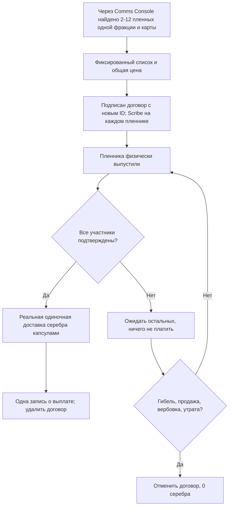
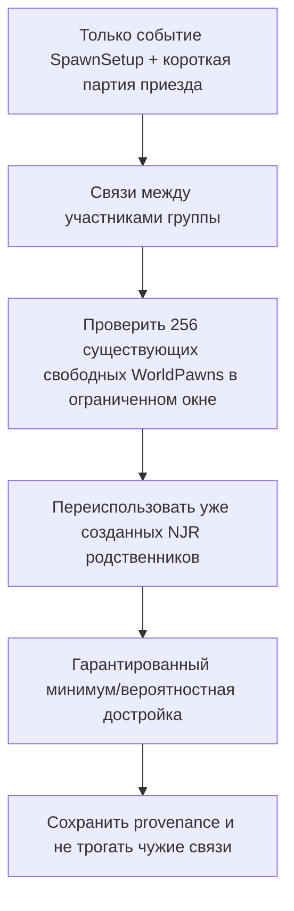

# Архитектура NJR R001 — пути данных, ответственность и «почему так»

## Кодовые центры ответственности

| Подсистема | Основные файлы | При каких событиях работает |
|---|---|---|
| семейный граф | `RaidersHaveFamilies.cs` (`RHFMapComponent`, `RHFGameLedger`), `RHFRanks.cs`, `RHFRankUI.cs` | `Pawn.SpawnSetup`, отложенный единичный batch, сохранение/загрузка и редкая очистка |
| дипломатия | `RHFDialogue.cs`, `RHFHostageSystems.cs`, `RHFPoliticalReputation.cs` | обычный Comms Console, физическое освобождение, редкое обновление переговоров |
| групповой выкуп V15 | `NJRGroupRansomV15.cs`, поля `RHFHostageRecord` и ledger | подпись, смерть, вербовка, реальный выход, редкий аудит |
| медицина/WCE2/Ideology | `RHFHostageSystems.cs`, `RHFWCERegistry.cs`, `RHFPatches.cs`, `RHFPreceptNotes.cs`, `RHFMercy.cs` | событие операции/конверсия/реальный публичный доклад |
| общая операция/сейв | `RHFOperations.cs`, `RHFMissionIntegrityV130.cs`, `RHFMissionProfiles.cs` | начало события, принадлежность бойцов, завершение, сериализация |
| тактика, путь, укрытие | `RHFObjectiveRouteV128.cs`, `RHFRescueGroundEntryS41.cs`, `RHFRescuePlannerS41.cs`, `RHFRescueCommandV124.cs`, `RHFRescueRoleJobGiverS41.cs` | наблюдение опасностей/цели, bounded replan, ThinkTree |
| VIP капсула и инженерия | `RHFVipEvacS311.cs`, `RHFPodPlannerS41.cs`, `NJRPodSiteClearS41.cs`, `RHFEnemyPodLaunchS41.cs`, `JobDriver_RHFPodCargoS41.cs` | фаза 3, реальная транспортная и строительная механика |
| debug/CI | `RHFDebugActions.cs`, `.github/workflows/build.yml`, `tests/*` | 18 игровых дев-тестов, CI статические проверки + реальная сборка на GitHub |

## Состояние группового выкупа (R001)

**Инварианты:** нельзя менять объявленный состав/цену на подтверждающем клике, нельзя платить за первую освобождённую пешку, нельзя вторично платить при дублирующемся exit hook, нельзя менять ванильное `Pawn.guest` ради быстрого выполнения. `Scribe`-ключи оставляют старые сделки без GroupRansomId как прежде. Физическая ошибка выдачи не считается успехом; безопасный повтор нуждается в отдельной модели/idempotency до реализации.

## Генерация семей (R001)

**Ограничения:** внешний список нельзя предполагать индексируемым (`IEnumerable<Pawn>`); ограничивать `foreach` до 511 обследований на arrival batch, не вызывать на каждом тике. Не всем модовым видам можно автоматически назначать родных. Реальные квесты/сохранения и социальная генетика ещё требуют независимого аудита.

## Разграничение знаний

- **Факт перехода в другую Ideology** известен игроку и пленнику, но не автоматически командованию исходной фракции. Репутация и шанс мести за это событие — только после действительного отправленного отчёта.
- **Вербовка** имеет отдельную систему возможной утечки через семь игровых суток; не смешивать с тайной сменой веры.
- Убийство/травма/каннибализм — разные события и доказательства. Нельзя ссылаться в разговоре на то, чего получатель не мог узнать.

## Что нельзя «чинить» удобным хаком

- Не делать `HostileTo` глобально дружественным для коалиций.
- Не создавать бесплатный телепорт пленника, капсулы и материалов.
- Не превращать абсолютно все задания в принудительный `Goto` каждые 90 тиков, не сбрасывать корректную работу инженера.
- Не менять public `packageId`, DLL и DefName ради названия.
- Не пускать случайный fallback рейда в непроходимые горы.
- Не считать локальные тесты Python проверкой игрового поведения или рантайм C#.
